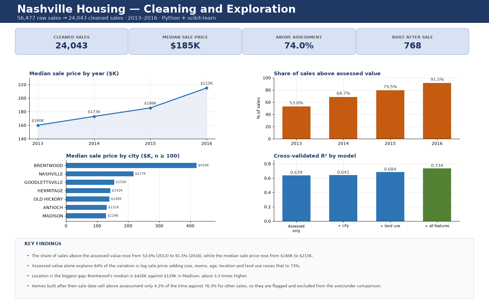
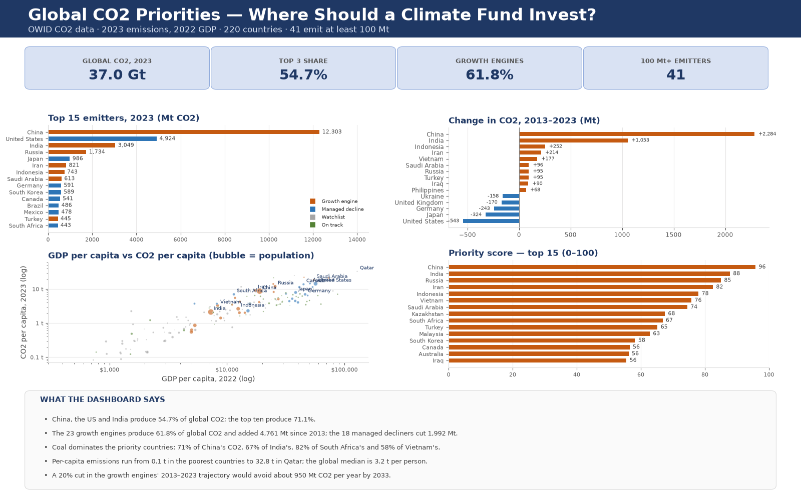

# Makafui Marvelous | Data Analyst Portfolio

> Data analyst skilled in Excel, SQL, Python and Tableau. I turn messy data into clear answers that help people make decisions.

📍 Accra,Ghana · 📧 marvelousmakafui76@gmail.com · 🔗 https://www.linkedin.com/in/marvelous-makafui-949678445?utm_source=share_via&utm_content=profile&utm_medium=member_android · 💻 https://github.com/Maka-Velli

---

## About Me

I recently completed a data analytics programme covering Excel, SQL, Python and Tableau. Before that I worked in It aupport, so I like analysis that connects directly to real business decisions. I'm looking for an entry-level data analyst role.

---

# Skills

| Area | Tools and techniques |
|---|---|
| **Spreadsheets** | Excel: PivotTables, XLOOKUP/VLOOKUP, conditional formatting, charts, data validation |
| **Databases** | SQL: joins, aggregations, CTEs, subqueries, window functions |
| **Programming** | Python: pandas, NumPy, Matplotlib, Jupyter Notebook |
| **Visualisation** | Tableau: calculated fields, filters, parameters, dashboards |
| **Other** | Data cleaning, exploratory analysis, storytelling with data, Git/GitHub |

---

## Projects

| # | Project | Tools | Skill shown |
|---|---|---|---|
| 1 | [Sales Performance Analysis](#1-sales-performance-analysis-excel) | Excel | Analysis and PivotTables |
| 2 | [E-commerce Business Questions](#2-e-commerce-business-questions-sql) | SQL | Querying relational data |
| 3 | [Data Cleaning and Exploration](#3-data-cleaning-and-exploration-python) | Python | Cleaning, EDA, visuals |
| 4 | [Capstone: End-to-End Analysis and Dashboard](#4-capstone-end-to-end-analysis-and-dashboard-tableau--python--sql) | Python, SQL, Tableau | Full workflow and recommendations |

---

## 1. Sales Performance Analysis (Excel)

### The question
Which products, regions and customer segments drive profit, and where is the business losing money?

### The data
- **Source:** Sample Superstore dataset (Kaggle / Tableau sample data), a fictional US retailer
- **Size:** 9,994 order lines × 21 columns (5,009 orders, 793 customers)
- **Period covered:** January 2014 to December 2017
- **Limitations:** No cost, marketing or returns data, one country, and a fictional company, so the findings show the method rather than a real business

### The process
1. **Loaded and checked the data:** the CSV was not UTF-8, so I read it as Windows-1252. No blanks, no fully duplicated rows, and no ship date earlier than its order date. Eight lines repeat an Order ID and Product ID pair but have different Row IDs, so I kept them as separate line items.
2. **Fixed data types:** converted Order Date and Ship Date from text to real dates.
3. **Added helper columns:** Order Year, Order Month, Profit Margin (Profit ÷ Sales) and Discount Band.
4. **Answered five questions** with summary tables (SUMIFS formulas, rebuilt as PivotTables for the interactive version): category and sub-category, region and state, trends over time, discount level, and customer segment.
5. **Built a Summary sheet** with headline numbers, four charts and the key findings.

### Key findings
Total sales were **$2.30M** and total profit **$286K**, a **12.5%** margin.

- **Furniture sells a lot but earns very little.** It brings in $742K in sales (second highest) but only a **2.5% margin**, against 17.4% for Technology and 17.0% for Office Supplies. It produces just 6.4% of total profit.
- **Three sub-categories lose money:** Tables (−$17.7K), Bookcases (−$3.5K) and Supplies (−$1.2K). The best are Copiers ($55.6K profit, 37% margin) and Phones ($44.5K).
- **Heavy discounts go with big losses.** Undiscounted lines earn a **29.5%** margin and 11 to 20% discounts earn 11.6%, but every discount band above 20% loses money overall, **−$135K in total**. 72% of all loss-making lines carry a discount above 20%. Tables only make a profit in total when sold with no discount (+$13.3K); every discounted band loses money.
- **The Central region is the weak spot.** Its margin is **7.9%**, against 14.9% in the West, even though it sells more than the South. Furniture loses money there (−$2.9K). **10 of 49 states lose money**, led by Texas (−$25.7K), Ohio (−$17.0K) and Pennsylvania (−$15.6K).
- **The business is growing.** Sales rose from $484K (2014) to $733K (2017) and profit from $49.5K to $93.4K. September, November and December are the strongest months.
- **No customer dependence.** The top 10 customers make up only 6.7% of sales. Home Office has the best segment margin (14.0%) and Consumer the lowest (11.5%).


### Recommendations
These are suggestions from the data. A real decision would also need cost and marketing information.

1. **Review discounts above 20%.** They account for $135K of losses, so setting an approval step or a cap is the largest single opportunity.
2. **Reprice or rethink Tables and Bookcases.** Both lose money overall, and Tables only break even at full price.
3. **Investigate Central and the loss-making states** (Texas, Ohio, Pennsylvania, Illinois) to see whether discounting, product mix or shipping costs explain the gap.
4. **Protect and grow the high-margin lines**, such as Copiers, Accessories and Paper, which combine strong margins (25 to 43%) with large profit totals.

📁 **Files:** [`/excel-sales-analysis`](./excel-sales-analysis) · Workbook: `superstore_sales_analysis.xlsx`

---

## 2. E-commerce Business Questions (SQL)

### The question
How is a Brazilian online marketplace performing, and where can it improve? I answered 8 business questions about revenue, categories, delivery, customers, sellers and payments using MySQL.

### The data
- **Source:** Brazilian E-Commerce Public Dataset by Olist (Kaggle), in a single pre-joined file
- **Size:** 113,390 rows in the file, which became 95,128 orders, 108,640 order items, 31,625 products, 2,914 sellers and 92,081 customers
- **Period covered:** October 2016 to August 2018
- **Database:** MySQL 8.0
- **Tables I built:** `customers`, `sellers`, `products`, `orders`, `order_items`, `order_payments`
- **Currency:** Brazilian reais (R$). Revenue means item price without freight, on delivered orders only.
- **Limitations:** No review scores in this version of the data, category names are in Portuguese, and the numbers before 2017 are very small

### The process
1. **Inspected the file.** It was one flat table with items and payments already joined together. That repeats an item once for every payment on its order, so adding up `price` on the raw file gives R$13.63M when the real total is R$13.05M, which is **4.5% too high**.
2. **Loaded it into a staging table** with `LOAD DATA`, then **split it into six tables** with primary keys and foreign keys (`schema.sql`). Before splitting, I checked that every key had only one set of values in the flat file, and I confirmed the row counts afterwards.
3. **Wrote 8 queries** using joins, aggregation, CTEs and window functions (`queries.sql`), leaving out the 6 cancelled orders.
4. **Checked the results** by recalculating each one separately in Python. All of them matched (`expected_results.md`).

### Selected queries

**Q3: Month-over-month revenue growth** (CTE and `LAG()`)
```sql
WITH monthly AS (
    SELECT DATE_FORMAT(o.order_purchase_timestamp, '%Y-%m') AS order_month,
           SUM(oi.price)                                    AS revenue
    FROM orders o
    JOIN order_items oi ON oi.order_id = o.order_id
    WHERE o.order_status = 'delivered'
      AND o.order_purchase_timestamp >= '2017-01-01'
    GROUP BY order_month
)
SELECT order_month,
       ROUND(revenue, 2)                                         AS revenue,
       ROUND(LAG(revenue) OVER (ORDER BY order_month), 2)        AS previous_month_revenue,
       ROUND(100.0 * (revenue - LAG(revenue) OVER (ORDER BY order_month))
                   / LAG(revenue) OVER (ORDER BY order_month), 1) AS mom_growth_pct
FROM monthly
ORDER BY order_month;
```
*Finding:* Revenue jumped 54% in November 2017, then fell 27% in December. The reason is one day: 24 November 2017 (Black Friday) had **1,140 orders**, against about 208 on a typical day that month.

**Q7: Top 10 sellers by revenue** (`RANK()` and share of total)
```sql
SELECT RANK() OVER (ORDER BY SUM(oi.price) DESC)                    AS revenue_rank,
       s.seller_id,
       s.state                                                      AS seller_state,
       COUNT(DISTINCT oi.order_id)                                  AS orders,
       ROUND(SUM(oi.price), 2)                                      AS revenue,
       ROUND(100.0 * SUM(oi.price) / SUM(SUM(oi.price)) OVER (), 2) AS pct_of_revenue
FROM order_items oi
JOIN orders  o ON o.order_id  = oi.order_id
JOIN sellers s ON s.seller_id = oi.seller_id
WHERE o.order_status = 'delivered'
GROUP BY s.seller_id, s.state
ORDER BY revenue_rank
LIMIT 10;
```
*Finding:* The top 10 sellers together make up only about 13% of revenue, and none is above 1.8%, so the marketplace does not depend on a few sellers. Nine of the ten are in São Paulo state.

The other six queries are in [`queries.sql`](./sql-ecommerce-analysis/queries.sql).

### Key findings
Delivered orders brought in **R$13.05M** from **95,122 orders**.

- **Fast growth.** Monthly revenue rose from R$108K in January 2017 to R$974K in May 2018. January to August 2018 earned R$7.1M, which is 143% more than the same months of 2017. Growth flattened after May 2018.
- **Revenue is spread across many categories, but a few lead.** The top 10 of 73 categories bring in 63% of revenue. Health and beauty is first (R$1.23M, 9.5%). Watches and gifts is second with far fewer items sold (5,857 against 10,952 for bed, bath and table, which is third), because its items cost about R$199 each against R$93.
- **Delivery depends heavily on location.** The average delivery takes 12.5 days and 6.8% of orders arrive late. São Paulo averages 8.7 days, while Amazonas takes 26.3 and Alagoas 24.4. Alagoas also has the highest late share (21.4%).
- **Shipping inside one state is twice as fast.** Same-state items arrive in 7.9 days against 15.0 days for items shipped between states, are late less often (4.4% against 7.8%), and cost less in freight (R$13.47 against R$23.67, or 13% of the price against 18%).
- **Customers rarely come back.** 97% of customers ordered only once, 2.7% ordered twice, and 0.2% three or more times.
- **Credit cards dominate payments.** They account for 78.5% of payment value, with an average of 3.5 installments. Boleto (bank slip) is next at 17.9%, then vouchers (2.2%) and debit cards (1.3%).


### Recommendations
These come from the data alone. A real decision would also need cost and customer information.

1. **Prepare for Black Friday.** One day brought more than five times the normal order volume, so stock, support and delivery capacity need planning for late November.
2. **Bring sellers and stock closer to customers outside São Paulo.** Same-state shipping is faster, less often late and cheaper, but only about a third of items travel that way.
3. **Review delivery estimates in the slowest states** such as Alagoas and Maranhão, where 21% and 18% of orders arrive late.
4. **Work on repeat purchases.** With 97% buying once, even a small improvement from follow-up emails or loyalty offers could add meaningful revenue. This would need testing.
5. **Promote high-value categories** such as watches and gifts, where each item earns much more than in the high-volume categories.

📁 **Files:** [`/sql-ecommerce-analysis`](./sql-ecommerce-analysis) · `schema.sql` (setup and import) · `queries.sql` (all 8 queries) · `expected_results.md` (results to check against)

---

## 3. Data Cleaning and Exploration (Python)

### The question
What drives the assessed value of a home in Nashville, and which sales came in over or under their assessed value?

### The data
- **Source:** Nashville housing sales (Kaggle)
- **Size:** 22,651 rows × 26 columns, one row per property sale
- **Period covered:** January 2013 to October 2016
- **Problems found:** 41 exact duplicate rows, an empty column, a constant column, a leftover index column, messy spacing in addresses and grade codes, text dates, missing values, impossible values (homes with 0 bedrooms), rare category codes, and 438 homes whose year built is *after* their sale date
- **Limitations:** The file has no sale price, only an Over/Under label (read here as sale price against assessed value, which is an assumption), and it does not say when the assessments were made

### The process
1. **Inspect:** `info()`, missing-value and unique-value counts, then a set of specific checks for duplicates, whitespace, odd values and rare categories
2. **Clean (every step logged with the row count after it):** dropped 3 useless columns, tidied column names to `snake_case`, removed 41 duplicates, trimmed text, converted dates and Yes/No columns, rounded finished area, set impossible 0-bedroom values to missing, grouped rare grade codes, and dropped the one row with no size. 22,651 rows became 22,609.
3. **Explore:** medians and log scales for the skewed values, group comparisons, correlations, and a cross-validated linear model on log value to compare how much location, size and grade each explain
4. **Check a suspicion:** homes built after their sale and vacant-land sales behaved very differently (over the assessed value only 4% and 11% of the time, against 77% for other sales). Their assessed value includes a building that probably did not exist at the time of sale, so I left them out of the over/under comparison. The trend does not depend on this choice (shown in the notebook).

### Key findings
- **Size comes first.** Finished area alone explains about **67%** of the variation in assessed value, and a home 10% larger is worth about 13% more.
- **Location adds the most on top of size** (67% to **90%** explained). Brentwood's median home is assessed at $371,700, against about $113,000 in Antioch and Madison, roughly 3.3 times higher.
- **Build grade adds 3 more points** (to 93%). Median value rises from $57K for grade E to $142K for C, $376K for B, $801K for A and $1.33M for X.
- **Age is not a straight line.** Homes from before the 1930s and from after 2000 are assessed higher than those from the 1950s to the 1980s.
- **The share of sales over the assessed value rose every year:** **56%** (2013), 73%, 83% and **92%** (2016, January to October). The rise appears in every large city. This fits a rising market if the assessments were set before 2013, but the file does not say, so it is an interpretation.



### What I'd do next
Get the actual sale price and the assessment date, and model price directly. Add neighbourhood names or map data to look at location in more detail, and compare this simple model with one that can handle interactions, such as gradient boosting.

📁 **Files:** [`/python-cleaning-eda`](./python-cleaning-eda) · Notebook: `analysis.ipynb` · Cleaned data: `nashville_housing_clean.csv`

---

## 4. Capstone: End-to-End Analysis and Dashboard (Tableau + Python + SQL)

**Suggested approach:** Pick a topic you actually care about so it's easier to talk about in interviews. Good sources are World Bank Open Data, Kaggle, government open-data portals, or public health and energy data. Pick a question a real organisation could ask.

### The business question
[Frame it like a manager would: "Which regions should we prioritise to reduce X?" or "What is driving the decline in Y?"]

### The data
- **Source(s):** [Name and links]
- **Size and period:** [...]
- **Limitations:** [...]

### The process
1. **Collect:** [where and how you got the data]
2. **Clean and prepare:** [Python or SQL]
3. **Analyse:** [methods, calculations]
4. **Visualise:** Tableau dashboard with [filters, parameters, key KPIs]

### Dashboard
🔗 **[View the live dashboard on Tableau Public](https://public.tableau.com/)**



### Key findings
1. [...]
2. [...]
3. [...]

### Recommendations
1. [Specific action, tied to a finding]
2. [...]

### Impact
[What decision this could support and roughly how much difference it could make.]

📁 **Files:** [`/capstone-project`](./capstone-project)

---

## Repository Structure

```
├── README.md
├── images/
├── excel-sales-analysis/
├── sql-ecommerce-analysis/
├── python-cleaning-eda/
└── capstone-project/
```

## Contact

I'm open to entry-level data analyst opportunities. The best way to reach me is **[email]** or **[LinkedIn]**.
