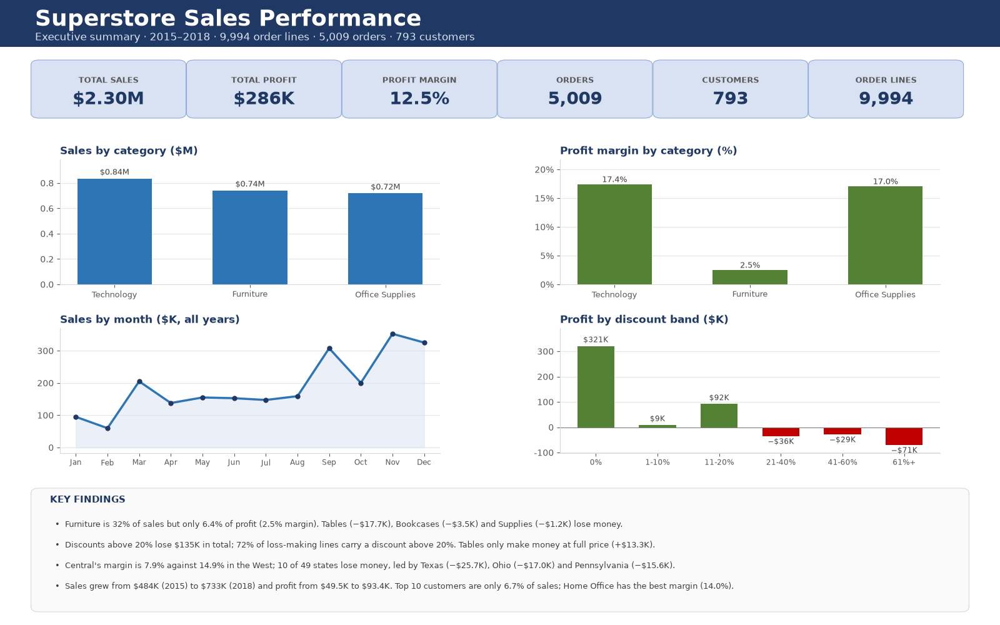
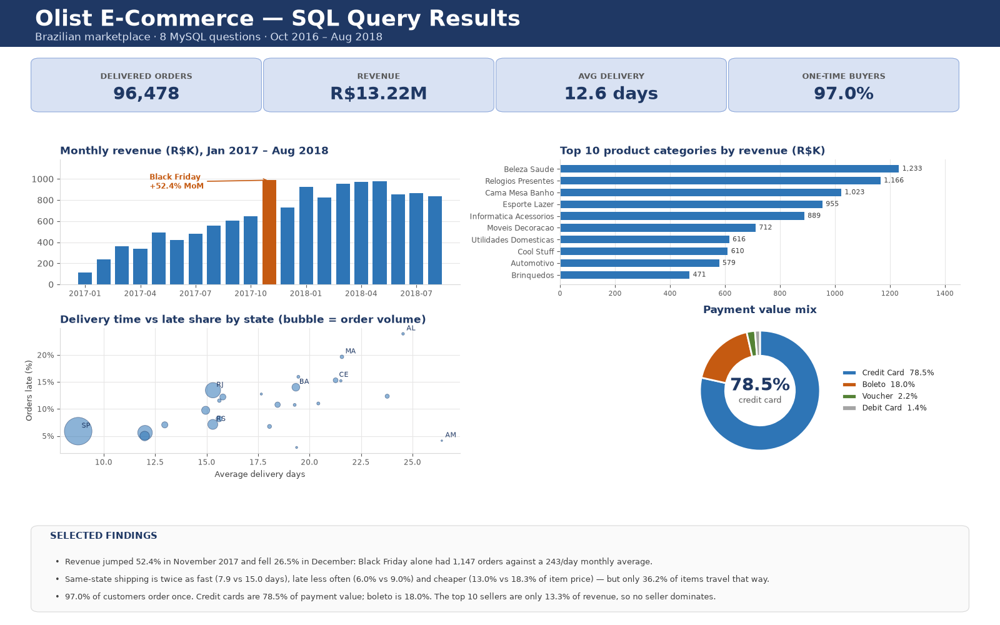

# Makafui Marvelous | Data Analyst Portfolio

> Data analyst skilled in Excel, SQL, Python and Tableau. I turn messy data into clear answers that help people make decisions.

📍 Accra, Ghana · 📧 marvelousmakafui76@gmail.com · 🔗 [LinkedIn](https://www.linkedin.com/in/marvelous-makafui-949678445) · 💻 [GitHub](https://github.com/Maka-Velli)

---

## About Me

I recently completed a data analytics programme covering Excel, SQL, Python and Tableau. Before that I worked in IT support, so I like analysis that connects directly to real business decisions. I'm looking for an entry-level data analyst role.

---

# Skills

| Area | Tools and techniques |
|---|---|
| **Spreadsheets** | Excel: PivotTables, XLOOKUP/VLOOKUP, SUMIFS, conditional formatting, charts, data validation |
| **Databases** | SQL: joins, aggregations, CTEs, subqueries, window functions, MySQL 8.0 |
| **Programming** | Python: pandas, NumPy, Matplotlib, scikit-learn, Jupyter Notebook |
| **Visualisation** | Tableau: calculated fields, filters, parameters, dashboards; Plotly: interactive dashboards |
| **Other** | Data cleaning, exploratory analysis, storytelling with data, Git/GitHub |

---

## Projects

| # | Project | Tools | Skill shown |
|---|---|---|---|
| 1 | [Sales Performance Analysis](#1-sales-performance-analysis-excel) | Excel | Analysis, SUMIFS and PivotTables |
| 2 | [E-commerce Business Questions](#2-e-commerce-business-questions-sql) | SQL | Querying relational data |
| 3 | [Data Cleaning and Exploration](#3-data-cleaning-and-exploration-python) | Python | Cleaning, EDA, visuals |
| 4 | [Capstone: Global CO2 Priorities](#4-capstone-global-co2-priorities-python--sql--plotly) | Python, SQL, Plotly | Full workflow and recommendations |

---

## 1. Sales Performance Analysis (Excel)

### The question
Which products, regions and customer segments drive profit, and where is the business losing money?

### The data
- **Source:** Sample Superstore dataset (Kaggle / Tableau sample data), a fictional US retailer
- **Size:** 9,994 order lines × 21 columns (5,009 orders, 793 customers, 1,862 products)
- **Period covered:** January 2015 to December 2018
- **Limitations:** No cost, marketing or returns data, one country, and a fictional company, so the findings show the method rather than a real business

### The process
1. **Loaded and checked the data:** the CSV was not UTF-8, so I read it as Latin-1. The source file also contained two stray helper tables after row 9,994; I kept only the real 9,994-row table. There were 11 missing postal codes (kept; they do not affect the totals), no fully duplicated rows, and no ship date earlier than its order date. Eight lines repeat an Order ID and Product ID pair but have different Row IDs, so I kept them as separate line items.
2. **Fixed data types:** converted Order Date and Ship Date from text to real dates.
3. **Added helper columns:** Order Year, Order Month, Profit Margin (Profit ÷ Sales) and Discount Band.
4. **Answered five questions** with summary tables built with SUMIFS formulas, plus pivot-style cross-tabs for region × category, segment × category, year × region and discount band × category.
5. **Built a Summary sheet** with headline numbers, four charts and the key findings.

### Key findings
Total sales were **$2.30M** and total profit **$286K**, a **12.5%** margin.

- **Furniture sells a lot but earns very little.** It brings in $742K in sales (second highest) but only a **2.5% margin**, against 17.4% for Technology and 17.0% for Office Supplies. It produces just 6.4% of total profit.
- **Three sub-categories lose money:** Tables (−$17.7K), Bookcases (−$3.5K) and Supplies (−$1.2K). The best are Copiers ($55.6K profit, 37% margin) and Phones ($44.5K).
- **Heavy discounts go with big losses.** Undiscounted lines earn a **29.5%** margin and 11 to 20% discounts earn 11.6%, but every discount band above 20% loses money overall, **−$135K in total**. 72% of all loss-making lines carry a discount above 20%. Tables only make a profit in total when sold with no discount (+$13.3K); every discounted band loses money.
- **The Central region is the weak spot.** Its margin is **7.9%**, against 14.9% in the West, even though it sells more than the South. Furniture loses money there (−$2.9K). **10 of 49 states lose money**, led by Texas (−$25.7K), Ohio (−$17.0K) and Pennsylvania (−$15.6K).
- **The business is growing.** Sales rose from $484K (2015) to $733K (2018) and profit from $49.5K to $93.4K. September, November and December are the strongest months.
- **No customer dependence.** The top 10 customers make up only 6.7% of sales. Home Office has the best segment margin (14.0%) and Consumer the lowest (11.5%).



### Recommendations
These are suggestions from the data. A real decision would also need cost and marketing information.

1. **Review discounts above 20%.** They account for $135K of losses, so setting an approval step or a cap is the largest single opportunity.
2. **Reprice or rethink Tables and Bookcases.** Both lose money overall, and Tables only break even at full price.
3. **Investigate Central and the loss-making states** (Texas, Ohio, Pennsylvania, Illinois) to see whether discounting, product mix or shipping costs explain the gap.
4. **Protect and grow the high-margin lines**, such as Copiers, Accessories and Paper, which combine strong margins (25 to 43%) with large profit totals.

📁 **Files:** [`/excel-sales-analysis`](./excel-sales-analysis) · Workbook: [`superstore_sales_analysis.xlsx`](./excel-sales-analysis/superstore_sales_analysis.xlsx) · Build script: `build_workbook.py`

---

## 2. E-commerce Business Questions (SQL)

### The question
How is a Brazilian online marketplace performing, and where can it improve? I answered 8 business questions about revenue, categories, delivery, customers, sellers and payments using MySQL.

### The data
- **Source:** Brazilian E-Commerce Public Dataset by Olist (Kaggle), six CSV files
- **Size:** 99,441 orders, 112,650 order items, 32,951 products, 3,095 sellers, 99,441 customers and 103,886 payments. The analysis uses **delivered orders only**: 96,478 orders, 110,197 order items, 32,216 products, 2,970 sellers and 93,358 unique customers
- **Period covered:** September 2016 to August 2018 (the last delivered order is 29 August 2018)
- **Database:** MySQL 8.0
- **Tables I built:** `customers`, `sellers`, `products`, `orders`, `order_items`, `order_payments`
- **Currency:** Brazilian reais (R$). Revenue means item price without freight, on delivered orders only.
- **Limitations:** No review scores in this version of the data, category names are in Portuguese, and the numbers before 2017 are very small

### The process
1. **Inspected the six CSV files** and checked their row counts and keys before loading anything.
2. **Loaded them into MySQL** with `LOAD DATA`, then added primary and foreign keys (`schema.sql`). All six foreign keys pass with zero orphan rows.
3. **Wrote 8 queries** using joins, aggregation, CTEs and window functions (`queries.sql`), leaving out the 2,963 orders that were not delivered (including 625 cancelled).
4. **Checked the results** by transpiling the same MySQL queries to DuckDB with `sqlglot` and running them against the CSV files. All headline numbers matched (`expected_results.md`).

### Selected queries

**Q3: Month-over-month revenue growth** (CTE and `LAG()`)
```sql
WITH monthly AS (
    SELECT DATE_FORMAT(o.order_purchase_timestamp, '%Y-%m') AS order_month,
           SUM(oi.price)                                    AS revenue
    FROM orders o
    JOIN order_items oi ON oi.order_id = o.order_id
    WHERE o.order_status = 'delivered'
      AND o.order_purchase_timestamp >= '2017-01-01'
    GROUP BY order_month
)
SELECT order_month,
       ROUND(revenue, 2)                                         AS revenue,
       ROUND(LAG(revenue) OVER (ORDER BY order_month), 2)        AS previous_month_revenue,
       ROUND(100.0 * (revenue - LAG(revenue) OVER (ORDER BY order_month))
                   / LAG(revenue) OVER (ORDER BY order_month), 1) AS mom_growth_pct
FROM monthly
ORDER BY order_month;
```
*Finding:* Revenue jumped 52.4% in November 2017, then fell 26.5% in December. The reason is one day: 24 November 2017 (Black Friday) had **1,147 orders**, against a 243-order daily average for the month.

**Q7: Top 10 sellers by revenue** (`RANK()` and share of total)
```sql
SELECT RANK() OVER (ORDER BY SUM(oi.price) DESC)                    AS revenue_rank,
       s.seller_id,
       s.seller_state,
       COUNT(DISTINCT oi.order_id)                                  AS orders,
       ROUND(SUM(oi.price), 2)                                      AS revenue,
       ROUND(100.0 * SUM(oi.price) / SUM(SUM(oi.price)) OVER (), 2) AS pct_of_revenue
FROM order_items oi
JOIN orders  o ON o.order_id  = oi.order_id
JOIN sellers s ON s.seller_id = oi.seller_id
WHERE o.order_status = 'delivered'
GROUP BY s.seller_id, s.seller_state
ORDER BY revenue_rank
LIMIT 10;
```
*Finding:* The top 10 sellers together make up only about 13% of revenue, and none is above 1.72%, so the marketplace does not depend on a few sellers. Nine of the ten are in São Paulo state.

The other six queries are in [`queries.sql`](./sql-ecommerce-analysis/queries.sql).

### Key findings
Delivered orders brought in **R$13.22M** from **96,478 orders**.

- **Fast growth.** Monthly revenue rose from R$111.8K in January 2017 to R$977.5K in May 2018. January to August 2018 earned R$7.22M, which is 141% more than the same months of 2017. Growth flattened after May 2018.
- **Revenue is spread across many categories, but a few lead.** The top 10 of 73 categories bring in 63.2% of revenue. Health and beauty is first (R$1.23M, 9.4%). Watches and gifts is second with far fewer items sold (5,859 against 10,953 for bed, bath and table, which is third), because its items cost about R$199 each against R$93.
- **Delivery depends heavily on location.** The average delivery takes 12.6 days and 8.1% of orders arrive late. São Paulo averages 8.7 days, while Amazonas takes 26.4 and Alagoas 24.5. Alagoas also has the highest late share (23.9%).
- **Shipping inside one state is twice as fast.** Same-state items arrive in 7.9 days against 15.0 days for items shipped between states, are late less often (6.0% against 9.0%), and cost less in freight (R$13.45 against R$23.63, or 13.0% of the price against 18.3%).
- **Customers rarely come back.** 97.0% of customers ordered only once, 2.8% ordered twice, and 0.2% three or more times.
- **Credit cards dominate payments.** They account for 78.5% of payment value, with an average of 3.5 installments. Boleto (bank slip) is next at 18.0%, then vouchers (2.2%) and debit cards (1.4%).



### Recommendations
These come from the data alone. A real decision would also need cost and customer information.

1. **Prepare for Black Friday.** One day brought more than four times the normal order volume, so stock, support and delivery capacity need planning for late November.
2. **Bring sellers and stock closer to customers outside São Paulo.** Same-state shipping is faster, less often late and cheaper, but only 36.2% of items travel that way.
3. **Review delivery estimates in the slowest states** such as Alagoas and Maranhão, where 24% and 20% of orders arrive late.
4. **Work on repeat purchases.** With 97% buying once, even a small improvement from follow-up emails or loyalty offers could add meaningful revenue. This would need testing.
5. **Promote high-value categories** such as watches and gifts, where each item earns much more than in the high-volume categories.

📁 **Files:** [`/sql-ecommerce-analysis`](./sql-ecommerce-analysis) · `schema.sql` (setup and import) · `queries.sql` (all 8 queries) · `expected_results.md` (results to check against) · `verify_results.py`

---

## 3. Data Cleaning and Exploration (Python)

### The question
What drives the sale price of a home in Nashville, and which sales came in over or under their assessed value?

### The data
- **Source:** Nashville housing sales (Kaggle)
- **Size:** 56,477 rows × 19 columns, one row per property sale
- **Period covered:** January 2013 to December 2016 (two records dated 2019 are dropped as errors)
- **Problems found:** 168 duplicate sales, text dates, a `SoldAsVacant` column written four ways (`Yes`, `No`, `Y`, `N`), missing owner and value fields for about 30,000 rows, 43 homes with 0 bedrooms, 39 land-use codes (many rare), and 783 homes whose year built is *after* their sale date
- **Limitations:** The file has the sale price and the assessed value, but it does not say when the assessments were made, and location is only available at city level

### The process
1. **Inspect:** `info()`, missing-value and unique-value counts, then a set of specific checks for duplicates, whitespace, odd values and rare categories
2. **Clean (every step logged with the row count after it):** dropped 168 duplicate sales, tidied column names to `snake_case`, parsed text dates and sale prices, normalised `SoldAsVacant`, converted the numeric fields, set impossible 0-bedroom values to missing, split the property address into street and city, grouped rare land-use codes, and dropped the two rows dated 2019. 56,477 rows became **24,043 rows × 26 columns**.
3. **Explore:** log-scale distributions for the skewed values, medians by year, city and decade, over/under assessment by year and city, correlations, and a cross-validated linear model on log sale price to compare how much location, size and land use each explain
4. **Check a suspicion:** homes built after their sale (4.2% over the assessed value, against 76.3% of other sales) and vacant-land sales (6.1%, against 75.2%) behaved very differently. Their assessed value includes a building that probably did not exist at the time of sale, so I left them out of the over/under comparison. The trend does not depend on this choice (shown in the notebook).

### Key findings
- **Most homes sell above their assessed value, and the share rises every year:** **53.0%** (2013), 68.7%, 79.5% and **91.5%** (2016). The median sale price rose from $160K to $215K over the same period.
- **The assessed value is the strongest single predictor of sale price.** On its own it explains **64%** of the variation in log sale price (cross-validated R²); adding size, rooms, age, location and land use raises that to **73%**.
- **Location matters more than any physical feature.** Brentwood's median sale is about **$420K**, against $129K in Madison and $131K in Antioch, roughly 3.3 times higher. Antioch has the highest over-assessment share (82.4%) and Madison the lowest (64.3%).
- **Size and rooms explain about 55% of the assessed value** (cross-validated R²); adding city raises it to 61% and land use to 65%.
- **Age is not a straight line.** Homes built before the 1930s and after 2000 sell for more than those from the 1950s to the 1980s: the 2010s median is $331K against $133K for the 1980s.
- **Vacant land behaves differently:** only 6.1% of vacant-land sales are above assessment, against 75.2% of improved properties.


### What I'd do next
Add the assessment date and neighbourhood data to model location more precisely, and compare this linear model with one that can handle interactions, such as gradient boosting.

📁 **Files:** [`/python-cleaning-eda`](./python-cleaning-eda) · Notebook: [`analysis.ipynb`](./python-cleaning-eda/analysis.ipynb) · Cleaned data: [`nashville_housing_clean.csv`](./python-cleaning-eda/nashville_housing_clean.csv)

---

## 4. Capstone: Global CO2 Priorities (Python + SQL + Plotly)

### The business question
Which countries should a climate investment fund prioritise to cut CO2 emissions?

### The data
- **Source:** [Our World in Data — CO2 and Greenhouse Gas Emissions data](https://github.com/owid/co2-data)
- **Size and period:** 56,269 rows × 79 columns, country-year from 1750 to 2025; the analysis uses 2023 emissions and 2022 GDP
- **Coverage:** 223 countries and territories; 220 have 2023 CO2 data and 41 emit at least 100 Mt
- **Limitations:** GDP data is only available to 2022, emissions are production-based (not consumption-based), and the data is country-level, so it cannot identify specific projects. This is a portfolio project, not investment advice.

### The process
1. **Collect:** downloaded the OWID CO2 CSV and filtered to ISO-coded countries, excluding OWID regions and income groups.
2. **Clean and prepare (Python):** built a 2023 snapshot, joined 2022 GDP and 2013 CO2, then calculated emissions growth, coal share, carbon intensity (CO2 per GDP), per-capita emissions and a priority score.
3. **Analyse:** segmented countries into four groups — growth engines (100 Mt+ and growing), managed decline (100 Mt+ and shrinking), watchlist and on track — and ranked the 41 major emitters with a weighted score:
   **40% absolute emissions + 30% growth 2013–2023 + 20% carbon intensity + 10% coal share**.
4. **Visualise:** an interactive Plotly dashboard with a world map, the top 15 emitters, GDP per capita against CO2 per capita, who added and who cut emissions, a priority table and 1990–2023 trend lines. The same summary queries are implemented in SQL (`capstone_analysis.sql`) and verified with DuckDB.

### Dashboard
🔗 **[Open the interactive dashboard](./capstone-project/dashboard.html)** (open the file in a browser; Plotly loads from a CDN)


### Key findings
1. **Emissions are concentrated.** The top three emitters — China, the United States and India — produce **54.7%** of global CO2; the top ten produce **71.1%**. The ten largest historical emitters account for **70.1%** of all CO2 released since 1750.
2. **Growth engines dominate the trend.** The 23 growth-engine countries produce **61.8%** of global CO2 and added **+4,761 Mt** between 2013 and 2023. The 18 managed decliners cut **−1,992 Mt** over the same period, led by the United States (−543 Mt), Japan (−324 Mt) and Germany (−243 Mt).
3. **The priority ranking is led by China and India.** China scores 95.8, India 87.8, Russia 85.0, Iran 82.5 and Indonesia 78.0. The full top 15 is in `summary/priority_table.csv` and on the dashboard.
4. **Coal is the dominant fuel in the priority countries.** It accounts for 71.1% of China's CO2, 66.6% of India's, 81.9% of South Africa's and 58.1% of Vietnam's.
5. **Per-capita emissions vary enormously.** Qatar emits 32.8 t per person, the United States 14.3 t and Australia 14.6 t, against a global median of 3.2 t.

### Recommendations
1. **Concentrate on the growth engines.** They are 61.8% of global CO2 and the only group still adding emissions at scale.
2. **Make coal the first target in China, India, Indonesia, Vietnam and South Africa**, where coal is 54–82% of emissions.
3. **Address per-capita laggards among rich countries** such as the United States, Australia, Canada and Saudi Arabia, where emissions are 13–18 t per person.
4. **Support the managed decliners to keep cutting.** The United States, Japan, Germany and the United Kingdom have shown that large absolute reductions are possible.
5. **Look at carbon intensity as well as totals.** Russia, Kazakhstan, South Africa and Iran have some of the highest CO2 per dollar of GDP, so efficiency gains there are cheap abatement.

### Impact
A 20% reduction in the growth engines' 2013–2023 trajectory would avoid roughly **950 Mt of CO2 per year by 2033**. Because the top three emitters are 54.7% of the total, progress in China, the United States and India dominates any global target.

📁 **Files:** [`/capstone-project`](./capstone-project) · `build_dashboard.py` · `dashboard.html` · `capstone_analysis.sql` · `summary/` (five CSV tables)

---

## Repository Structure

```
├── README.md
├── images/                       # previews used in this README
├── excel-sales-analysis/         # workbook, build script, data download
├── sql-ecommerce-analysis/       # schema, queries, expected results, verifier
├── python-cleaning-eda/          # executed notebook, cleaned CSV, build script
└── capstone-project/             # dashboard, SQL, summary tables, build script
```

## Data Sources

- [Sample Superstore](https://www.kaggle.com/datasets/vivek468/superstore-dataset-final) — Tableau sample data
- [Brazilian E-Commerce Public Dataset by Olist](https://www.kaggle.com/datasets/olistbr/brazilian-ecommerce) — Kaggle
- [Nashville Housing Data](https://www.kaggle.com/datasets/taylorhughes/nashville-housing-data) — Kaggle
- [Our World in Data — CO2 and Greenhouse Gas Emissions](https://github.com/owid/co2-data) — OWID

Raw CSV files are not committed; each project folder has a `download_data.py` that fetches its dataset. The cleaned Nashville dataset is included because it is a deliverable.

## Contact

I'm open to entry-level data analyst opportunities. The best way to reach me is **[email](mailto:marvelousmakafui76@gmail.com)** or **[LinkedIn](https://www.linkedin.com/in/marvelous-makafui-949678445)**.
